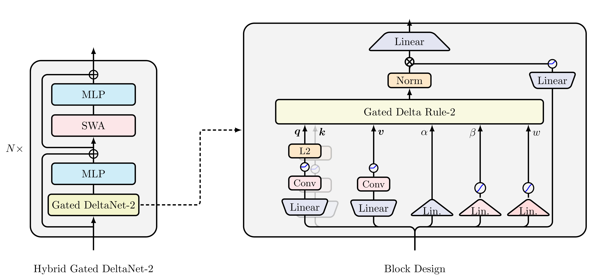

# 🔺 Gated DeltaNet-2: Decoupling Erase and Write in Linear Attention

Official PyTorch implementation of [**Gated DeltaNet-2: Decoupling Erase and Write in Linear Attention**](https://arxiv.org/abs/2605.22791).

[](https://github.com/NVlabs/GatedDeltaNet-2/stargazers)

[Ali Hatamizadeh](https://ahatamiz.github.io),
[Yejin Choi](https://homes.cs.washington.edu/~yejin/), and
[Jan Kautz](https://jankautz.com/).

<p align="center">
  
</p>

## 📢 Latest Updates
- `09/24/2026`: 🔥🔥  **Gated DeltaNet-2** has been accepted to **NeurIPS 2026** ! 🎉 🎊🥂 
- `05/21/2026`: 🔥 **Code Release**: Train your own Gated DeltaNet-2 on FineWeb-Edu
- Watch this space for more exciting updates!

## 🌟 Why Gated DeltaNet-2?

Linear attention compresses an unbounded KV cache into a fixed-size recurrent state. The hard part is not just *what to forget*, but *how to edit* this compressed memory without scrambling existing associations. Prior delta-rule models (Gated DeltaNet, Kimi Delta Attention) tie *erasing* and *writing* to a single scalar gate — even though they act on different axes of the state.

**Gated DeltaNet-2** decouples these two roles:

- ✂️ **Channel-wise Erase Gate `b_t`** — selects which *key-side* coordinates of the decayed state are read and removed
- ✍️ **Channel-wise Write Gate `w_t`** — selects which *value-side* coordinates of the new content are committed
- 🌀 **Channel-wise Decay** — inherited from KDA for fine-grained global forgetting
- 🔁 **Strict Generalization** — recovers KDA when both gates collapse to the same scalar, and Gated DeltaNet when the decay also collapses
- ⚡ **Hardware-efficient Training** — fast-weight WY chunkwise algorithm with gate-aware backward, fused in Triton


<p align="center">
  
</p>


## 📐 The Gated Delta Rule-2

Given an erase gate `b_t ∈ [0,1]^{d_k}`, a write gate `w_t ∈ [0,1]^{d_v}`, and channel-wise decay `D_t = Diag(α_t)`, the recurrent state evolves as:

```
S_t = (I − k_t (b_t ⊙ k_t)ᵀ) D_t S_{t−1}  +  k_t (w_t ⊙ v_t)ᵀ
```

Compared with KDA, the right factor of the rank-one erase becomes channel-selective on the *key* axis, and the write term becomes channel-selective on the *value* axis. The two decisions no longer share a single scalar.


## 📊 Results

We train all models at **1.3B parameters on 100B tokens of FineWeb-Edu**, matched in recurrent state size, and compare against Mamba-2, Gated DeltaNet, KDA, and Mamba-3 (SISO and MIMO).

### Language Modeling and Commonsense Reasoning

Gated DeltaNet-2 achieves the best average across both **recurrent-only** and **hybrid** settings:

| Model | Wiki ppl ↓ | LMB ppl ↓ | LMB acc ↑ | Avg. acc ↑ |
|---|---|---|---|---|
| **Recurrent** | | | | |
| Mamba-2 | 16.79 | 12.38 | 45.24 | 51.82 |
| Gated DeltaNet | 16.40 | 11.89 | 49.62 | 52.07 |
| KDA | 16.81 | 11.68 | 48.13 | 52.28 |
| Mamba-3 (MIMO) | 16.45 | 11.66 | 47.82 | 52.39 |
| **Gated DeltaNet-2** | **15.90** | **11.41** | 48.09 | **53.11** |
| **Hybrid (+ SWA)** | | | | |
| Transformer | 19.22 | 13.72 | 48.32 | 50.86 |
| Gated DeltaNet | 16.00 | 10.82 | 48.71 | 52.25 |
| KDA | 16.01 | 10.66 | 49.21 | 52.68 |
| Mamba-3 (MIMO) | 15.81 | 10.92 | 49.82 | 52.72 |
| **Gated DeltaNet-2** | **15.62** | **10.43** | **50.90** | **53.97** |

### Long-context Retrieval (RULER)

Gated DeltaNet-2 is strongest where memory editing matters most — particularly the interference-heavy multi-key needle-in-a-haystack settings:

| Model | S-NIAH-2 @4K | S-NIAH-3 @2K | MK-NIAH-1 @4K |
|---|---|---|---|
| **Recurrent** | | | |
| Gated DeltaNet | 87.2 | 54.2 | 27.8 |
| KDA | 89.0 | 63.2 | 28.0 |
| Mamba-3 (MIMO) | 64.2 | 72.4 | 18.0 |
| **Gated DeltaNet-2** | **93.0** | **89.8** | **37.8** |
| **Hybrid** | | | |
| Gated DeltaNet | 57.3 | 91.2 | 44.8 |
| KDA | 56.0 | 93.4 | 40.4 |
| Mamba-3 (MIMO) | 53.0 | 98.4 | 46.6 |
| **Gated DeltaNet-2** | **57.9** | **99.0** | **48.0** |

### Real-world Retrieval

Across SWDE, SQuAD, FDA, TriviaQA, NQ, and DROP, Gated DeltaNet-2 leads the recurrent and hybrid frontier:

| Setting | Mamba-2 | GDN | KDA | Mamba-3 (MIMO) | **GDN-2** |
|---|---|---|---|---|---|
| Recurrent avg. | 26.84 | 28.09 | 28.67 | 28.35 | **29.88** |
| Hybrid avg. | 39.74 | 39.11 | 40.14 | 40.11 | **42.28** |

### Throughput

Gated DeltaNet-2 retains near-flat scaling with sequence length on a single H100 (training, hybrid 1.3B), with only a small constant overhead over KDA for the added channel-wise gates.


## 🔧 What's New in the Update Rule

| Method | Decay | Erase | Write |
|---|---|---|---|
| Mamba-2 | scalar | — | scalar |
| Gated DeltaNet | scalar | scalar `β_t` | scalar `β_t` |
| KDA | **channel-wise** | scalar `β_t` | scalar `β_t` |
| **Gated DeltaNet-2** | **channel-wise** | **channel-wise `b_t`** | **channel-wise `w_t`** |

Ablations confirm both gates contribute, with the **erase gate `b_t` accounting for most of the gain** — consistent with its role in selectively protecting or revising key-side associations in the recurrent state.


## 🚀 Getting Started

### Fastest B300 training path

**For a supported GB300/B300 machine, use this path first:**

> **GDN-2 optimized = packed projections + cuDNN FROST + Transformer Engine
> FP8 + CUDA Graph replay.**

```python
layer = GatedDeltaNet2(
    hidden_size=3072,
    head_dim=64,
    num_heads=48,
    expand_v=2,
    backend="cudnn",          # native FROST recurrence
    fused_projections=True,    # one packed input projection
)
```

Wrap the fixed-shape training step in `transformer_engine.fp8_autocast` and
capture it with `torch.cuda.CUDAGraph`. The packed/FROST/TE-FP8/Graph
combination is the fastest measured path in this repository. The plain Triton
and BF16 configurations are portability and baseline paths; they are not the
recommended B300 performance configuration. FROST requires cuDNN 1.32+ with
the native GDN-2 engine, and CUDA Graph replay requires fixed batch and
sequence shapes.

The ready-to-run layer benchmark is:

```bash
python scripts/benchmark_gdn2_backend.py \
  --fastest \
  --batch 8 --seq 512
```

`--fastest` is shorthand for `--backend cudnn --fused-projections --fp8
--graph`.

### GB300/Blackwell acceleration

The portable default is Triton for compatibility. On cuDNN 1.32+ with a
supported SM100/SM103 GPU, the performance path uses cuDNN's native FROST
recurrence while retaining the CroissAttn beta guard:

```python
layer = GatedDeltaNet2(
    hidden_size=3072,
    head_dim=64,
    num_heads=48,
    expand_v=2,
    backend="cudnn",
    fused_projections=True,
)
```

`fused_projections=True` packs Q/K/V/erase/write and the two low-rank input
projections into fewer GEMMs. It is opt-in and has checkpoint migration for the
legacy projection names. Native FROST is measured at roughly 1.7–2.0× the
Triton recurrence throughput on GB300; complete-model gains are smaller because
the FFN, attention, and language-model head remain significant costs. The
native path supports key/value head dimensions 64 and 128 and falls back to
Triton only when selected explicitly by the caller.

For fixed-shape training, `disable_recompute=True` requests that the chunkwise
WY intermediates be retained for backward. It is an opt-in memory/compute
tradeoff for the Triton chunk path; on the current `D=3072, S=4096` benchmark
it did not change step time within measurement noise, so it should be enabled
only after checking the memory budget. Native FROST ignores this option.

The measurements below use `B=1`, `H=48`, `K=64`, `V=128`, and include forward
and backward work. They isolate the recurrence, so they should not be read as
end-to-end model speedups:

| Sequence length | Triton recurrence | cuDNN FROST recurrence | FROST speedup |
| ---: | ---: | ---: | ---: |
| 512 | 1.987 ms / 257.6k tok/s | 0.970 ms / 528.0k tok/s | 2.05× |
| 1024 | 1.940 ms / 528k tok/s | 1.015 ms / 1.009M tok/s | 1.91× |
| 4096 | 2.522 ms / 1.624M tok/s | 1.454 ms / 2.816M tok/s | 1.73× |

At a batch size representative of filling a per-GPU token budget (`B=8,
S=512`, 4096 tokens per step), the complete packed layer shows the effect of
combining the optimizations:

| Path | Step | Tokens/s/GPU | Relative to legacy Triton/BF16 |
| --- | ---: | ---: | ---: |
| Legacy projections + Triton + BF16, eager | 4.761 ms | 0.860M | 1.00× |
| Legacy projections + Triton + BF16, graph | 3.647 ms | 1.123M | 1.31× |
| Packed projections + FROST + BF16, graph | 2.853 ms | 1.436M | 1.67× |
| **Packed projections + FROST + TE FP8, graph (fastest)** | **2.642 ms** | **1.550M** | **1.80×** |

These are forward/backward/AdamW timings on one GB300, with fixed-shape graph
replay. They demonstrate the combined layer-level gain; they are not a claim
that the entire 600M training step is 2× faster.

A geometry sweep found `H=24, K=128, V=128` about 5.7% faster than the
`H=48, K=64, V=128` layer, but it removes about 28.7M parameters per layer and
reduces recurrent state capacity. The optimized recipe keeps the larger state
for apples-to-apples model comparisons.

At the smaller `B=1, S=512` shape, where launch overhead is a larger fraction
of the step, the same optimized path measured `1.080 ms` (`474k` tokens/s)
versus `4.521 ms` (`113k` tokens/s) for legacy Triton/BF16 eager, or `4.19×`.
The larger-batch table above is the more representative throughput comparison.

For the packed `D=3072` layer at `S=4096`, the measured FROST step is
`5.267 ms` (`777.6k` tokens/s) including projections, recurrence, output path,
and AdamW. A packed Triton CUDA-Graph step is `3.842 ms` (`1.066M` tokens/s)
for a recurrence-focused layer benchmark. In the complete synthetic 599.7M
model (`3×` GDN-2 + `1×` flash attention), packed projections plus CUDA Graphs
measured about `19.38 ms` per step, or `211k` tokens/s per GPU at `S=4096`.
The full-model component profile at `B=1, S=4096` measured `22.21 ms` for
packed Triton BF16, `22.88 ms` for the current eager TE FP8 recipe, and
`20.72 ms` for packed FROST with TE FP8. The remaining time is dominated by
backward/loss and AdamW, so the current evidence demonstrates a recurrence-level
2× result but does not demonstrate a 2× end-to-end model result. FP8 should be
re-measured at the intended per-GPU batch size before being selected as the
training default. These component numbers use a square loss to isolate the
model path; the training entry point uses the repository's fused cross-entropy
loss, which should be used for final language-model throughput claims.

The same 603.6M-parameter synthetic stack (`3×` GDN-2 + `1×` flash attention)
was also captured at `B=8, S=512` (the same 4096 tokens per step). Full graph
replay measured `20.82 ms` (`197k` tokens/s) for packed Triton/BF16 and
`16.60 ms` (`247k` tokens/s) for packed FROST/TE FP8, a `1.25×` end-to-end
step improvement. The layer-level gain is larger because the full model's
attention, FFN, LM head, and optimizer remain on the critical path.

Using the actual repository `FusedCrossEntropyLoss` lowers the optimized full
step to `15.267 ms` (`268.3k` tokens/s/GPU) with `8.40 GiB` peak allocation.
The square-loss numbers above are useful for component isolation; this fused-CE
number is the appropriate language-model training result. A matched BF16
fused-CE baseline is still needed before claiming a full-model 2× improvement.

Keeping the LM head in TE FP8 is a small but measurable win in that same
fused-CE graph: `15.255 ms` / `268.5k` tokens/s/GPU versus `15.665 ms` /
`261.5k` with a BF16 head. FP8 uses about `176 MiB` more peak memory, so it is
the preferred setting when the per-GPU memory budget allows it.

For multi-GPU testing, [`scripts/benchmark_gdn2_ddp.py`](scripts/benchmark_gdn2_ddp.py)
launches with `torchrun`, reports the slowest rank's step time, and uses manual
gradient all-reduce during graph capture because wrapping the DDP reducer itself
is not graph-safe on the tested PyTorch build. A single-rank GB300 smoke test of
packed FROST/BF16 graph mode at `B=1,S=128` measured `1.022 ms`; an eight-GPU
B300 result still requires eight identical devices and has not been claimed here.

The implementation follows the current [Flash Linear Attention GDN-2
layout](https://github.com/fla-org/flash-linear-attention/tree/main/fla/ops/gdn2),
including token-parallel intra-chunk score construction and shape-aware Triton
autotuning. The head-wise decay construction here also avoids a temporary
flattened `repeat_interleave(A_log)` buffer.

### KDA and FA baselines

The repository includes the pinned KDA kernel snapshot under
`third_party/flash_linear_attention/` and a matched comparison harness:

```bash
python scripts/benchmark_kda_fa.py --layer gdn2 --backend triton --batch 1 --seq 512
python scripts/benchmark_kda_fa.py --layer kda --batch 1 --seq 512
python scripts/benchmark_kda_fa.py --layer fa --batch 1 --seq 512
```

These GB300 measurements use `D=3072`, `H=48`, `d_head=64`, `expand_v=2`,
BF16, eager forward/backward, and fused AdamW:

| Layer | Parameters | Step | Tokens/s |
| --- | ---: | ---: | ---: |
| GDN-2, packed Triton | 86.91M | 3.906 ms | 131.1k |
| KDA, FLA reference | 58.75M | 4.510 ms | 113.5k |
| FA, causal PyTorch SDPA | 37.75M | 0.971 ms | 527.2k |

The KDA snapshot retains the upstream MIT license and depends on the normal
FLA package for shared utility kernels. FA uses causal `scaled_dot_product_attention`,
which dispatches to the available Blackwell flash-attention implementation.

### Training Your Model

Launch your training with our streamlined command:

```bash
python ../pretrain.py \
--train_data_dir ${TRAIN_DATA} \
--val_data_dir ${VALIDATION_DATA} \
--output_root ${SAVE_DIR} \
--exp_name ${NAME} \
--model_name ${MODEL} \
--train_config ${CONFIG} \
--eval_iters ${EVAL_ITERS} \
--learning_rate ${LR} \
--micro_batch_size ${MICRO_BATCH_SIZE}
```

💡 **Pro Tip**: Add `--interactive_job --debug` for interactive debugging sessions!

### Default Recipe

We train 1.3B-parameter models on 100B tokens of FineWeb-Edu with:

- AdamW, peak LR `4e-4`, weight decay `0.1`, gradient clip `1.0`
- Cosine schedule with 1B-token warmup
- Global batch size `0.5M` tokens, sequence length `4K`
- Hybrid models use a `2K` sliding-window attention size
- 16 heads, `d_k = d_v = 128`, matched recurrent state size against Mamba-2/3 baselines


## 📜 License

Copyright © 2026, NVIDIA Corporation. All rights reserved.

Licensed under the NVIDIA Source Code License-NC. See [LICENSE](LICENSE) for details.


## 🙏 Acknowledgements

Built on the shoulders of giants:
- [Gated DeltaNet](https://github.com/NVlabs/GatedDeltaNet)
- [Kimi Delta Attention](https://arxiv.org/abs/2510.26692)
- [Flash Linear Attention](https://github.com/fla-org/flash-linear-attention)
- [Samba](https://github.com/microsoft/Samba)
- [LiTGPT](https://github.com/Lightning-AI/litgpt)


## 📖 Citation

If you find this work useful, please consider citing:

```bibtex
@article{hatamizadeh2026gated,
  title={Gated DeltaNet-2: Decoupling Erase and Write in Linear Attention},
  author={Hatamizadeh, Ali and Choi, Yejin and Kautz, Jan},
  journal={arXiv preprint arXiv:2605.22791},
  year={2026}
}
```


## ⭐ Support Us

If you find this work useful, please consider:
- Starring the repository
- Citing our paper
- Contributing to the codebase

Join us in pushing the boundaries of linear attention! 🚀


## Star History

[](https://github.com/NVlabs/GatedDeltaNet-2/stargazers)


[](https://star-history.com/#NVlabs/GatedDeltaNet-2&Date)
